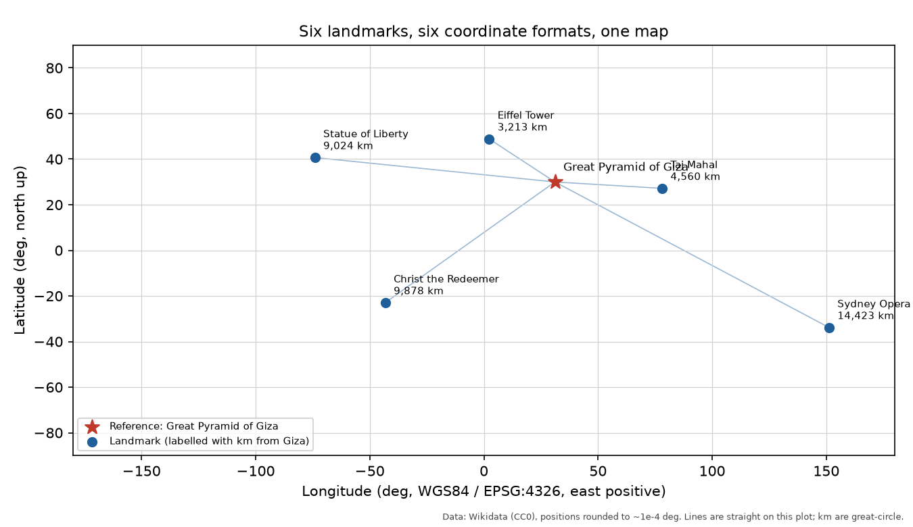

<p align="center">
  <picture>
    <source media="(prefers-color-scheme: dark)" srcset="assets/brand/logo-dark.svg">
    
  </picture>
</p>

# dms-convert

Part of [OpenTerra](https://github.com/AmmarYasser455), a family of open GIS tools. Parse and convert coordinates between decimal degrees (DD), degrees-minutes-seconds (DMS) and degrees-decimal-minutes (DDM), with tolerant parsing of messy real-world input.

Coordinates arrive in many shapes: `40°26'46"N 79°58'56"W` in a report, `40 26.767 N, 79 58.933 W` from a GPS unit, `-79.98, 40.44` in a spreadsheet. This tool reads those variants and writes a consistent format. It has no dependencies.

## Install

```
pip install git+https://github.com/AmmarYasser455/dms-convert
```

## Command line

```
$ dms-convert "40°26'46\"N 79°58'56\"W" --to ddm
40°26.7667'N 79°58.9333'W

$ dms-convert "40.7128, -74.006" --to dms
40°42'46.08"N 74°00'21.60"W

$ dms-convert "W 74 0 21.6, N 40 42 46.08"
40.712800°N 74.006000°W

$ dms-convert "40S, 10E"
40.000000°S 10.000000°E

$ dms-convert "N 40.7128 74.006 W"
40.712800°N 74.006000°W

$ dms-convert "-33.8688, 151.2093" --to ddm
33°52.1280'S 151°12.5580'E

$ dms-convert "95 N 10 E"
error: lat 95.0 out of range (±90)
```

Options: `-t/--to {dd,dms,ddm}` (default `dd`), `-p/--precision N` (0 to 12 decimals of the last unit). With no arguments, one pair per line is read from stdin; empty input is a usage error. Exit status is 1 if any input failed to parse. Arguments that start with a negative number (e.g. `"-33.8688, 151.2093"`) are read as coordinates, not options; `--` before them also works. `python -m dms_convert` works too.

## Python

```python
from dms_convert import parse_coordinate, parse_angle, to_dms, format_coordinate

lat, lon = parse_coordinate("40°26'46\"N 79°58'56\"W")   # (40.4461..., -79.9822...)
parse_angle("0°30'S")                                    # -0.5
to_dms(40.7128, "lat")                                   # 40°42'46.08"N
format_coordinate(lat, lon, "ddm", precision=2)
```

Invalid text raises `ValueError`; a non-string input to the parsers, or a non-number (including `bool`) to the formatters, raises `TypeError`. The formatters also reject NaN, infinity, out-of-range values and unknown axes.

## Example: messy table to a GeoJSON map

`examples/landmarks.csv` lists six landmarks, each written in a different style (DMS with quotes, spaced DMS, signed decimals, DDM with prefixed letters, `d m s` letters, longitude first). `examples/make_geojson.py` parses them with `parse_coordinate` and writes `examples/landmarks.geojson`, a point layer in WGS84 with `[longitude, latitude]` order (RFC 7946) that GitHub renders as a map:

```
python examples/make_geojson.py
```

A row of the output:

```json
{"type": "Point", "coordinates": [151.2153, -33.8569]}
"properties": {"name": "Sydney Opera House", "input": "-33.8569, 151.2153", "dms": "33°51'25\"S 151°12'55\"E"}
```

The test suite regenerates the layer and compares it with the checked-in file, and checks each point against the landmark's published position within 0.001°.

`examples/demo.ipynb` is a small offline notebook that does the same parsing and prints the three formats; the test suite executes its code cells and checks the printed output.

Data source and license: the six positions are the coordinates of each landmark's Wikidata item (property P625, "coordinate location"; Wikidata structured data is CC0 1.0), entered by hand and rounded to about 1e-4°, then written in the different text styles of `landmarks.csv`. They were not re-downloaded or re-verified by the test suite, so they are approximate, not survey-grade. The independent reference values in `tests/test_examples.py` come from the same source rounded to 1e-3°. The CSV, GeoJSON and notebook are distributed under the repository's MIT license.

Try the notebook in Colab (badge below) or view the [demo map](https://ammaryasser455.github.io/dms-convert/) (`docs/demo.geojson`, kept equal to the tool's output by a test). See `examples/README.md` for data sources.

[](https://colab.research.google.com/github/AmmarYasser455/dms-convert/blob/main/examples/demo.ipynb)

## Showcase



Six landmarks written in six coordinate styles, parsed and measured from the Great Pyramid of Giza. See [showcase/](showcase/) for the report, web map, notebook and GeoJSON; rebuild with `python showcase/make_showcase.py`.

## Accepted input

- Units: `°`, `'`, `"`, `′`, `″`, `d m s`, `deg min sec`, or plain spaces/tabs/colons. An explicit unit is honoured (`46"` is 46 seconds, `40°30"` is 40°00'30"); unmarked numbers take the next unit after the previous one. Units must be in degree, minute, second order.
- Hemisphere letters `N S E W` before or after each part, mixed placement included (`N 40.7 74.0 W`, `40.7 N W 74.0`); with letters, longitude may come first. Without a separator, a prefix-plus-suffix pair must make the split clear: two plain numbers, or degree marks (`N 40°42' 74°0' W`).
- Signed values (`-79.98`) instead of letters. Without letters the order is lat, lon.
- Separators: comma, semicolon, slash, `|`, or whitespace.
- Rejected: latitude beyond ±90, longitude beyond ±180, minutes or seconds of 60 or more (also when they come first, e.g. `60'` or `3600"`), a sign combined with a hemisphere letter, two values on the same axis.

## Limitations

- Only a lat/lon pair per input; no UTM, MGRS or other grid systems.
- Decimal commas (`40,5`) are not supported; a comma is always a separator.
- A bare pair without letters is assumed to be lat, lon (not lon, lat).
- Two unmarked whitespace-separated numbers (`40 30`) are read as a lat, lon pair by `parse_coordinate`, while `parse_angle("40 30")` reads them as 40°30'. Input that is only one angle in marked or colon form (`40°30`, `40:30`, `40°30'`) is rejected by `parse_coordinate` instead of being turned into a pair; numbers after `:` always belong to the same angle.
- `S` is treated as the southern hemisphere when it is uppercase or separated by whitespace (`40S`, `40 s`). A lowercase `s` touching a number is read as seconds only after a minutes mark (`40d26m46s`, `40°26'46s`); otherwise (`46s`, `40°30s`) it is rejected as ambiguous. Use `"` or `sec` for seconds.
- Only ASCII digits are accepted; `nan`, `inf`, exponents (`1e5`) and hemisphere words (`north`) are rejected.
- Only the last number of an angle may have decimals.
- Output is rounded for display; no datum handling.

## Input validation

Every public function validates its input at the boundary: parsers accept only `str` (`None`, numbers, bytes, lists, mappings raise `TypeError`); empty, whitespace-only, NaN/inf text and wrong-shaped pairs raise `ValueError`; formatters accept only finite real numbers in range, a known axis, an integer precision of 0 to 12 and a known format. `tests/test_boundaries.py` runs all of these cases from one table.

## Development

```
pip install -e .[test]
python -m pytest
```

MIT licensed, see `LICENSE`.
