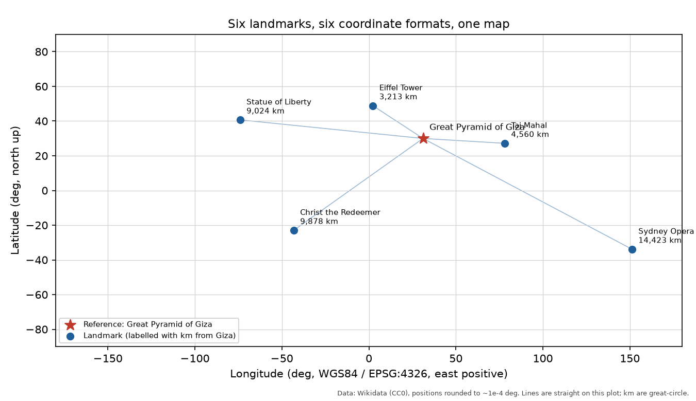

# Six landmarks, six coordinate formats

## Question

Can dms-convert read six real landmark positions written in six different text styles, and how far is each one from the Great Pyramid of Giza in Cairo?

## Data

- `data/landmarks.csv`: six landmarks (Eiffel Tower, Statue of Liberty, Sydney Opera House, Christ the Redeemer, Great Pyramid of Giza, Taj Mahal), each position written in a different style. Copy of `examples/landmarks.csv`.
- Source: the coordinate location (property P625) of each landmark's Wikidata item, https://www.wikidata.org/ . Entered by hand and rounded to about 1e-4 degrees, so approximate, not survey-grade.
- License: Wikidata structured data is CC0 1.0. The map base in `index.html` is OpenStreetMap, (c) OpenStreetMap contributors (ODbL); `map.png` uses no base map.
- Date fetched: 2026-11-15 (the file is the one already in this repository; nothing was downloaded).

## Method

- `dms_convert.parse_coordinate` reads each text into `(lat, lon)` in decimal degrees, WGS84 (EPSG:4326). GeoJSON output is `[lon, lat]` (RFC 7946); the table and popups give lat, lon.
- Distance from Giza to each landmark: haversine great-circle distance on a sphere of radius 6371.0088 km, result in kilometres. This is a spherical approximation; it can differ from ellipsoidal distance by up to about 0.5 %.
- `to_dms` writes each parsed position back as whole-second DMS for the popups.

## Results

- All six texts parsed; the parsed points match the Wikidata positions to about 1e-4 degrees.
- Nearest to Giza (excluding Giza itself): Eiffel Tower, 3,212.8 km.
- Taj Mahal: 4,559.5 km.
- Farthest: Sydney Opera House, 14,423.3 km.
- Statue of Liberty 9,023.8 km, Christ the Redeemer 9,877.7 km.

## Map



- Web map: [index.html](index.html) (Leaflet; needs internet for tiles; serve the folder, e.g. `python -m http.server`, since the page fetches `map.geojson`)
- Notebook: [showcase.ipynb](showcase.ipynb)
- Data: [map.geojson](map.geojson)

## Rebuild

```
python showcase/make_showcase.py
```

Runs offline from `data/`; needs matplotlib for `map.png`. The notebook outputs are saved in the file.
